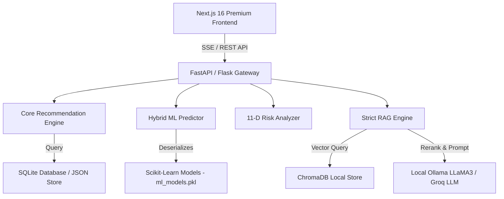

# InsightRural — AI-Powered College Admission Intelligence & Counseling Platform 🎓🚀


> **InsightRural** is a flagship Generative AI & Machine Learning platform designed to bridge the educational guidance gap for engineering (KEA KCET, JoSAA JEE) and medical (MCC NEET) aspirants across India, with special emphasis on rural and underrepresented students.

---

## ✨ Key Features & Technical Highlights

### 🎯 1. Multi-Factor Hybrid ML College Predictor
- **Ensemble Regression**: Combines linear trend extrapolation with Gradient Boosting Regressors trained on 5+ years of historical KEA/JEE/NEET cutoffs.
- **Dynamic Reservation Rules Engine**: Full simulation of official Karnataka KEA reservation matrix (GM, SC, ST, 2A, 2B, 3A, 3B, CAT-1, SNQ, Rural 15%, Kannada Medium 5%, and Hyderabad-Karnataka 371J).
- **Unified Hybrid Recommendation Score**: Multi-criteria weighted scoring considering Rank Match (40%), Branch Preference (20%), Category Match (15%), Location (10%), Fee Affordability (10%), and Placement (5%).
- **Dynamic Probability Calibration**: Categorizes options into **Safe (80%+ chance)**, **Moderate (45-80%)**, and **Dream (<45%)** options with XAI (Explainable AI) rationales.

### 🧠 2. 11-Dimensional Student Risk & Regret Analyzer
- Analyzes candidate profile across 11 key dimensions: Academic pressure, financial burden, placement ROI, career alignment, location advantage, and burnout risk.
- Computes **Compound Regret Risk Score** and 5-Year Return on Investment (ROI) projections.

### 💬 3. Multilingual GenAI Admission Counselor & RAG Suite
- **Retrieval-Augmented Generation (RAG)**: Uses **ChromaDB** vector database to query official counseling circulars, fee structures, and document verification rules.
- **Multilingual Support**: Provides counseling responses in English, Kannada, and Hindi.
- **Real-Time Streaming**: Low-latency Server-Sent Events (SSE) chat stream interface.

### 📜 4. Automated Option Entry Generator & PDF Report Suite
- Generates optimal serial-dictatorship option entry lists (Dream ➔ Target ➔ Safety).
- One-click downloadable PDF report summary containing custom career roadmaps and fee estimates.

---

## 🏗️ System Architecture



---

## 🛠️ Technology Stack

| Layer | Technology |
|---|---|
| **Frontend Framework** | Next.js 16 (App Router), React 19, TypeScript, Tailwind CSS, Framer Motion, Recharts |
| **Backend Services** | FastAPI 0.104+, Flask 2.3 (Legacy compatibility), Python 3.10+ |
| **Machine Learning** | Scikit-learn (Gradient Boosting, Ridge, Random Forest), NumPy, Pandas |
| **Generative AI & RAG** | ChromaDB, Sentence-Transformers (`all-MiniLM-L6-v2`), Ollama LLaMA 3, Groq API |
| **Database & Storage** | SQLite / PostgreSQL (SQLAlchemy ORM), JSON-first service layer |
| **Reporting & Export** | FPDF2, PyMuPDF (Fitz), LangChain Text Splitters |

---

## 🚀 Quick Start & Installation

### Prerequisites
- Python 3.10+
- Node.js 18+ & npm
- (Optional) [Ollama](https://ollama.com) with `llama3` pulled for offline AI chat

### 1️⃣ Backend Setup

```bash
# Navigate to backend directory
cd college/backend

# Create virtual environment
python -m venv .venv
# Activate on Windows:
.venv\Scripts\activate

# Install production dependencies
pip install -r requirements.txt

# Start FastAPI production server
python main.py
```
*Backend runs at `http://127.0.0.1:5000` (or `http://localhost:8000` for FastAPI standalone).*

### 2️⃣ Frontend Setup

```bash
# Navigate to frontend directory
cd premium-frontend

# Install dependencies
npm install

# Start Next.js development server
npm run dev
```
*Frontend runs at `http://localhost:3000`.*

---

## 📌 Core API Endpoints

| Method | Endpoint | Description |
|---|---|---|
| `POST` | `/api/predict/college` | Returns ML-driven KCET college predictions with Safe/Moderate/Dream tiers |
| `POST` | `/api/analyze/risk` | Computes 11-dimensional regret risk, success score, and 5-year ROI |
| `POST` | `/api/chat/stream` | Server-Sent Events (SSE) streaming RAG AI chat endpoint |
| `POST` | `/api/simulate-career` | Generates 3-track career roadmaps (Placement, Higher Studies, Startup) |
| `GET` | `/api/colleges` | Searchable college directory with fuzzy filtering & fee categories |
| `POST` | `/api/report/generate` | Generates downloadable PDF counseling report |

---

## 🔒 Security & Best Practices
- **No API Keys in Repo**: Environment configurations are isolated in `.env` (gitignored). Reference `.env.example` for setup.
- **Strict CORS & Input Validation**: Typed Pydantic v2 schemas enforce type safety across all endpoints.
- **Fail-Safe Fallbacks**: Multi-level fallback architecture (ML Model ➔ Historical Rule Engine ➔ Data Service) guarantees zero downtime.

---

## 📄 License
This project is developed for final-year academic research and production demonstration purposes.
