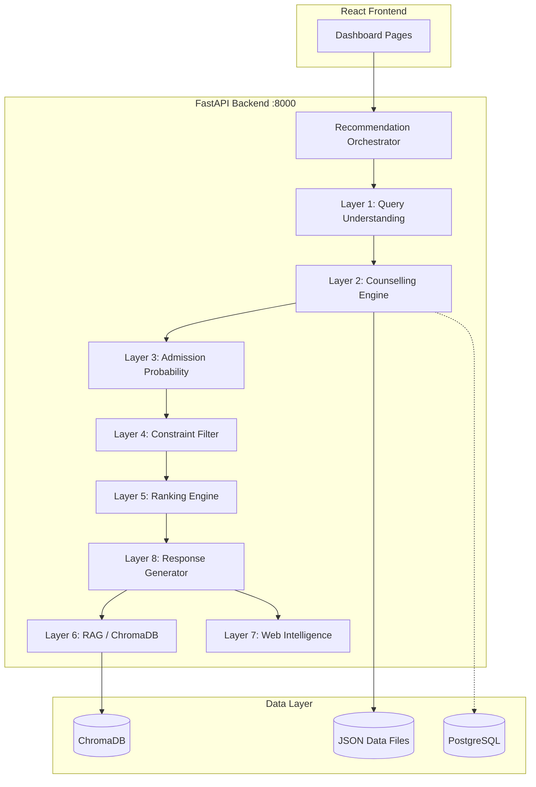

# Architecture — KCET Counselling Platform v3.0

## System Overview

## Layer Responsibilities

| Layer | Module | LLM? | Purpose |
|-------|--------|------|---------|
| 1 | `query_understanding.py` | No | Extract rank, city, budget, quotas |
| 2 | `counselling_engine.py` | No | KEA eligibility, reservation rules |
| 3 | `admission_probability.py` | No | RF/XGB/LGBM + rule-based probability |
| 4 | `constraint_filter.py` | No | Hard filters — never relaxed |
| 5 | `ranking_engine.py` | No | Weighted composite scoring |
| 6 | `rag/chroma_client.py` | No | Semantic document search |
| 7 | `web_intel/official_sources.py` | No | Official source URLs only |
| 8 | `llm/response_generator.py` | Yes | Explain only — never select |

## Ranking Weights

- 40% admission probability
- 20% placements
- 15% accreditation (NAAC)
- 10% hostel quality
- 10% fees (budget fit)
- 5% location preference

## Tier Classification

| Tier | Probability | Label |
|------|-------------|-------|
| SAFE | > 80% | High confidence admission |
| MODERATE | 50-80% | Realistic target |
| AMBITIOUS | < 50% | Stretch goal |

## Confidence Score

Calculated from:
- Profile completeness (rank present)
- Number of matching colleges after filters
- Average data completeness across results

Never defaults to 95%+ without sufficient data.

## Security

- Input validation (Pydantic)
- Rate limiting (60 req/min)
- Audit logging
- Prompt injection sanitization
- JWT RBAC for admin endpoints

## Deployment

See `DEPLOYMENT.md` for Docker, Kubernetes, and CI/CD setup.
