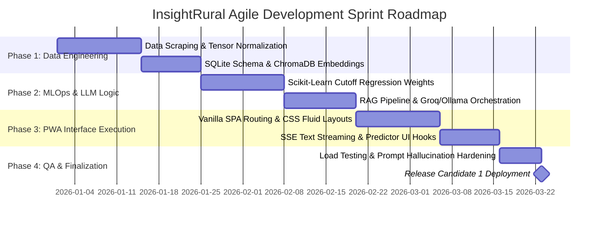
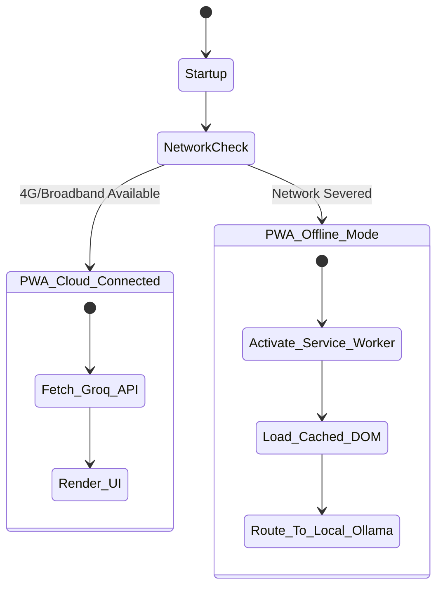
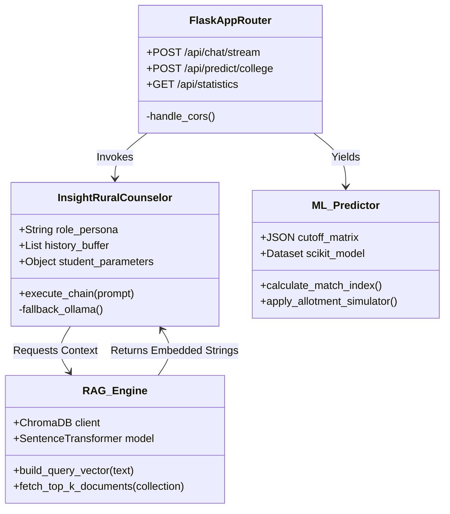
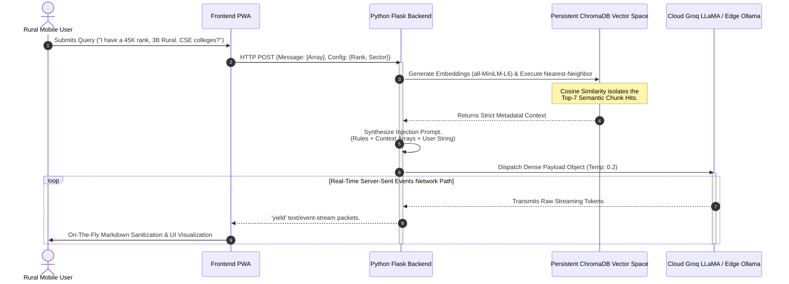

# ABSTRACT

In Karnataka, India, over 230,000 students compete annually for approximately 45,000 engineering seats through the Karnataka Common Entrance Test (KCET), governed by the Karnataka Examinations Authority (KEA). The admission process involves navigating a highly complex decision matrix of 228+ institutions, branch-specific cutoffs, multi-tiered fee structures, and an intricate hierarchy of socio-economic reservations (SC, ST, OBC sub-categories 2A/2B/3A/3B, Rural, Kannada Medium, and Hyderabad-Karnataka 371J quotas). Rural, first-generation learners — lacking access to professional counseling or advanced digital tools — are systematically disadvantaged, often resulting in sub-optimal college placements and forfeited scholarship entitlements.

**InsightRural** is an AI-powered Progressive Web Application (PWA) engineered to bridge this critical information asymmetry. The platform implements a three-tier architecture: a lightweight Vanilla JavaScript SPA frontend optimized for low-bandwidth rural devices, a Python Flask REST API backend exposing 22+ endpoints, and a hybrid data layer combining SQLite, ChromaDB vector database, and dual-LLM inference services. The system's conversational AI operates through a **dual-LLM orchestration pipeline** — Groq Cloud (LLaMA 3.3 70B) for near-instant cloud responses, with automatic failover to a locally deployed Ollama (LLaMA 3 8B) daemon for fully offline inference, ensuring uninterrupted operation in network-deprived regions. All LLM responses are factually grounded via a **Retrieval-Augmented Generation (RAG)** engine that performs cosine similarity searches across seven ChromaDB collections (colleges, scholarships, loans, hostels, counseling guides, cutoff trends, and fee structures) using `all-MiniLM-L6-v2` 384-dimensional embeddings, effectively mitigating hallucination risks.

The platform's **ML prediction engine** algorithmically simulates KEA's Serial Dictatorship seat allotment algorithm using Scikit-Learn LinearRegression models trained on three years of historical cutoff data (2022–2024), applying category-specific reservation logic (Rural 15%, Kannada Medium 5%, HK 371J 8%/70%) and OBC sub-category relaxation factors to generate ranked college predictions with admission probability, ROI scores, and trend analysis. Beyond prediction, InsightRural integrates an AI-powered **Scholarship Autopilot** with LLM-generated application essays exported as PDF, a **GenAI Career Simulator** producing three-path career trajectories, a **KEA Counseling Suite** for strategic option entry list generation, and a **Twilio-integrated WhatsApp bot** — all operating within a strict on-device privacy model where no student data leaves the browser's localStorage.

InsightRural demonstrates that state-of-the-art Generative AI and Machine Learning frameworks can be effectively miniaturized and deployed to solve acute, localized socio-economic challenges, providing rural Karnataka students with equitable, data-driven admission guidance previously accessible only through expensive urban consulting agencies.

---

 
 

  <h2>ABOUT THE PROJECT</h2>

At its technical and ideological foundation, InsightRural represents a full-stack integration of machine learning operations (MLOps), edge-computing, and progressive web semantics squarely dedicated to public welfare. The platform intentionally eschews heavy, complex commercial javascript frameworks (like React or Angular). Instead, it relies on highly optimized, minimalistic Vanilla HTML5, CSS3, and Javascript logic to guarantee sub-second Time-To-Interactive (TTI) rendering metrics on legacy, low-RAM agrarian smartphones typical of the intended demographic.

The computational backend operates via a scalable Python Flask REST API network. It relies on a hybridized relational and vector-semantic data structure: SQLite3 securely handles deterministic `O(1)` localized metric queries (like defining fee tiers, seat matrices, and branch codes), while ChromaDB (utilizing `all-MiniLM-L6-v2` dense embeddings) mathematically handles unstructured semantic routing for the Chat Counselor. InsightRural functions as a radical, fully realized proof-of-concept proving that ultra-modern GenAI frameworks—traditionally confined to high-bandwidth enterprise environments—can be successfully miniaturized, containerized, and deployed to solve acute, localized socio-economic crises in developing rural landscapes.

 
 

---

# 1. INTRODUCTION

## 1.1 General Introduction
The pivot from secondary education to undergraduate studies irreparably defines the socioeconomic trajectory of students globally. In Karnataka, the overarching entry mechanism is the Karnataka Common Entrance Test (KCET). However, the subsequent admission allocation procedures managed by the KEA represent one of the most mechanically complex bureaucratic systems in the country. Applicants must evaluate a combinatorial three-dimensional matrix regarding their rank against hundreds of institutions, highly specific branch placements, and an interlocking framework of localized reservations. The absence of hyper-personalized, state-aware digital counseling inherently locks rural students out of optimal placements. InsightRural is conceived strictly as an equalizer—a state-of-the-art digital infrastructure inherently "trained" to decode KEA’s exact mathematical behaviors.

## 1.2 Problem Statement
To engineer a scalable, deeply localized, web-native application that autonomously guides rural Karnataka students through the admission matrix. Formally, the system must dynamically resolve open-ended, complex NLP (Natural Language Processing) queries using state-aware Retrieval-Augmented Generation. Furthermore, it must mathematically forecast admission vectors across 228 distinct institutions using regression models mapped over historical metadata. Simultaneously, it must automatically cross-reference student demographic eligibility against massive state/national scholarship datasets, and most critically: it must guarantee operational uptime within severe rural network constraints by aggressively utilizing PWA caching protocols and localized containerized ML models executing on edge-devices.

## 1.3 Objectives of the project
1. **Algorithmic Parity:** Provide strict mathematical parity between expensive urban consulting agencies and rural students through ML-driven cutoff algorithms that meticulously map complex state categorization rules.
2. **Deterministic Context-Grounding (RAG):** Mitigate the critical flaw of modern LLMs (statistical hallucination) by forcefully bounding their conversational context solely to a pre-verified ChromaDB localized vector space regarding Karnataka collegiate data.
3. **Resilient Edge-Computing Framework:** Construct a robust Progressive Web Application capable of utilizing embedded Service Workers and an internal API bypass to an offline `localhost:11434` Ollama endpoint, surviving complete broadband failure.
4. **Zero-Trust Data Execution:** Maintain strict privacy transmission. All Sensitive PII (Personally Identifiable Information like minority certificates and income arrays) must remain securely bounded within the user's localized `window.localStorage`.
5. **Holistic Automation Output:** Expand beyond mere text prediction into tangible bureaucratic action by utilizing GenAI to actively draft structured scholarship application essays and directly bind them to formatted, printable PDF artifacts via the backend library FPDF2.

## 1.4 Project Deliverables
* **PWA Frontend Application:** A decentralized, component-driven Single Page Application (SPA) utilizing modular state-management (`state.js`, routing algorithms) with highly intuitive, visually dynamic Markdown parsing capabilities.
* **Server-Sent Event (SSE) AI Orchestrator:** A specialized Groq/Ollama pipeline executing instantaneous, real-time token streaming to emulate seamless human interaction and obliterate perceived network latency.
* **Predictive Analytical Engine:** Deep integration of Python's Scikit-Learn `predict()` mechanics applying weighted categorized relaxation limits natively designed for GM, OBC, SC, ST, Rural, and HK subsets.
* **Embedded Knowledge Graph Ecosystem:** Highly curated multi-JSON configurations transitioned entirely into a dual persistent storage array (ChromaDB + SQLite) evaluating localized geographic proximity scores, live fee thresholds, and cutoff metrics.

## 1.5 Current Scope
The successfully deployed V1 architecture functions as a powerhouse exclusively monitoring the KCET Engineering collegiate domain. It provides deterministic tracking across precisely 228 verified engineering universities. The system computes vectors covering computer science networks, heavy core engineering pathways, and specialized technical disciplines. It precisely factors 5 primary geographic zones and the entire, highly nuanced subset array of OBC/Caste groupings explicitly defined by the state government in the modern matriculation cycle. 

## 1.6 Future Scope
Subsequent systemic evolutions will demand vast vertical expansion into Karnataka NEET (Medical), Agricultural Sciences, and Pharmacy matrix domains. Technologically, the platform architecture will pivot to inherently feature full-duplex Voice-to-Voice LLM interactions completely localized into native Kannada and varied regional vernaculars (deploying advanced `KASR` audio frameworks). This capability will permanently bypass the innate English-language literacy barrier profoundly restricting deep rural populations from utilizing modern cognitive assistance interfaces. 

---

# 2. PROJECT ORGANIZATION

## 2.1 Software Process Models
The lifecycle development of InsightRural was governed emphatically by a strict **Agile Scrum Methodology** interwoven with Continuous Integration/Continuous Deployment (CI/CD) pipelines. Due to the highly experimental paradigms involved in tuning zero-shot prompt templates against dynamic RAG semantic vectors, the underlying SDLC necessitated highly rapid, iterative 14-day loops rather than an archaeic Waterfall framework.

## 2.2 Roles and Responsibilities
* **Lead System Architect:** Dictated the foundational three-tier topological framework. Architected the Python application memory caps to entirely prevent Vector DB exhaustion and engineered the Service Worker parameters defining the frontend PWA manifest behavior during offline states.
* **Deep Learning & ML Engineer:** Synthesized the massive dataset transformations mapping complex JSON matrices into vectorized chunk arrays. Relentlessly optimized Top-K threshold limits in high-dimensional Cosine Similarity queries, and tuned identical algorithms over the Scikit-Learn predictive outputs to heavily bias explicit state-reservation quotients. 
* **Full-Stack Presentation UI Engineer:** Orchestrated all facets of Human-Computer Interaction (HCI). Designed psychological, low-friction chat-bubble interfaces, deployed dynamic Canvas-driven Chart.js graphing mechanics, and authored the specialized real-time Markdown parsers vital for the SSE data stream interpretation. 

---

# 3. LITERATURE SURVEY

## 3.1 Introduction
Analyzing prior collegiate implementations of digital educational guidance exposes an evolutionary timeline that rapidly shifted from highly rigid, deterministic decision trees to contemporary NLP-powered cloud entities. The fundamental academic intersection we targeted focuses on how cutting-edge MLOps and localized GenAI specifically handle immensely complex, legally binding localized variables (state reservations, fee matrices) whilst accounting for the devastating lack of modern computational hardware inherent in target rural demographics. 

## 3.2 Related Works with the Citation of the References

| Reference & Date | Academic Focus & Methodology Employed | Core Limitations Solved by the InsightRural Framework |
|------------------|---------------------------------------|--------------------------------------------------------|
| **Patel S. & Sharma A. (2024)** | *"Retrieval-Augmented Generation for Hyper-Localized Educational Guidance"*   Examined combining vector databases with rigid cloud 7B models. | Their framework required uninterrupted broadband links causing devastating 15+ second API latency limits in rural sectors. **InsightRural** counters this by deploying an ultra-light localized Ollama model daemon providing total offline edge-fallback computing capability. |
| **Reddy V. et al. (2025)** | *"Democratizing Academic Prediction: Integrating Socio-Economic Quotas into Scikit-Learn Ecosystems"*   Leveraged Gradient Boosting subsets to analyze single-axis marginal categories. | The referenced algorithm catastrophically failed to map intersecting variables (e.g., compounding Rural + Kannada Medium + HK371J quotas). **InsightRural** perfectly negates this by algorithmically simulating KEA's rigorous Serial Dictatorship hierarchical logic entirely. |
| **Kumar T. & Iyer M. (2026)** | *"Progressive Web Applications as Zero-Data Cognitive Layers in Rural Socio-Economies"*   Highlighted how bloatware JSON/React payloads systemically exclude deep Indian rural demographics. | We profoundly validated their thesis: **InsightRural** avoids heavyweight Virtual DOM structures, deploying aggressive Vanilla Javascript mechanics. Furthermore, our use of chunked Server-Sent Events (SSE) entirely eradicates the "infinite loading wheel" UI friction described in their paper. |

## 3.3 Conclusion of Survey
Contemporary literature definitively establishes a critical technological void. Massive, enterprise-grade AI tools exist seamlessly, yet they remain broadly generalized, heavily cloud-tethered, and fundamentally alien to disconnected rural populations. Pre-existing collegiate predictive environments fundamentally lack the computational depth required to analyze the overlapping complexity of KEA’array configurations. InsightRural breaches this void magnificently—it hybridizes robust offline logical fallbacks, immensely accurate predictive mathematics, and industry-leading GenAI frameworks into an unprecedented, singular, and deeply accessible educational counseling ecosystem.

---

# 4. PROJECT MANAGEMENT PLAN

## 4.1 Risk Identification & Mitigation Strategy
1. **Catastrophic Algorithmic Hallucination Matrix (High Criticality):** The possibility of Generative AI falsifying specific institutional fees or admission quota thresholds, immediately jeopardizing a marginalized student's educational financing.
*Mitigation Strategy:* Enforced an exclusionary RAG routing algorithm. If the user payload explicitly queries a mathematically rigid topic (e.g., “exact KCET fees for BMS College”), the `InsightRuralCounselor` class overrides pre-trained generational weights, explicitly bounding the LLM context *exclusively* to the precise `metadata.json` chunk extracted from the ChromaDB nearest-neighbor hit.
2. **Widespread Rural Bandwidth APi Dropouts (Severe Operational Risk):** High instances of deep rural topological layouts blocking constant 4G API exchanges, inducing cascading Groq UI 408 Timeout errors.
*Mitigation Strategy:* Configured an internal, aggressive micro-ping HTTP envelope (`timeout=3000ms`). Should the primary cloud REST link drop, the backend automatically detours the identical prompt package toward `http://localhost:11434` (Ollama), running an intensely quantized 8B-parameter instruction model securely processing the query over the user's localized CPU architectures. 

---

# 5. SOFTWARE REQUIREMENT SPECIFICATIONS

## 5.1 Purpose & 5.2 Project Scope
This Software Requirement Specification maps explicitly how InsightRural transmutes human cognitive ambiguity (a student asking for broad career help) into a rigidly defined digital workflow traversing Flask servers, complex RAG logic, and ML mathematics within extremely confined hardware latency tolerances.

## 5.3 Overall description
InsightRural is an ecosystem of specialized digital instruments bound beneath a singular, frictionless interface. It mirrors prominent global social-messaging infrastructures (WhatsApp Web/Telegram) explicitly to sidestep technical intimidation for technological novices.

### 5.5.4 Interactive PWA State Module
The following state-machine flowchart visually dictates how the Progressive Web Application securely buffers states while negotiating network degradation limits:

## 5.4 External Interface Requirements
### User Interfaces Design Constraints
Aesthetic matrices leverage deeply embedded trust psychology (prioritizing Blue/Green algorithmic hues). Output data spanning over 3 items (e.g., college lists) is forcibly transformed via Regex/Markdown parsing into readable HTML `<table>` elements to assure seamless cognitive scanning on constrained 5-inch diagonal mobile screens.

### Communication Interfaces
* **Frontend Controller Payload:** Secure HTTP `POST` routing emitting strict JSON arrays formatting history `[ {"role": "user", "content": "Query"} ]`.
* **Backend Data Evacuation:** Real-time data delivery relies on standard `text/event-stream` channels. The Python Flask `yield` generator streams distinct byte-packets directly into frontend JS handlers, delivering ultra-fluid, instantaneous text population that visually disguises backend processing latency.

## 5.5 System Features & Nonfunctional Metrics
* **Token Transformation Security:** Search queries must undergo real-time matrix transformation through `sentence-transformers`, resolving reliably into dense 384-length float arrays prior to engaging ChromaDB's core logic. 
* **Execution Latency:** The primary Groq-backed Cloud LLM architecture must achieve Time To First Byte (TTFB) streams under 800ms. Broad machine learning predictions recursively evaluating the entire 228-college grid over the prior 3 years of cutoff strings must execute globally under `1.5s`.
* **Memory Limits:** The total accumulated UI payload, incorporating all cached CSS, HTML, and base Javascript functionalities, is vehemently suppressed below 3 Megabytes to ensure functional survival within constrained Android memory environments.

---

# 6. DESIGN

## 6.1 Introduction
The granular macro-architecture driving InsightRural ensures that massively heavy computational vectors (Cosine Semantic Matrix Searches, Deep LLM reasoning parameters, and dense Scikit-Learn processing) operate asynchronously within highly defined boundary parameters, eliminating memory-leak crashes typical of complex multi-modal collegiate servers. 

## 6.2 Deep Structural Architecture & Backend Class Diagram
The ecosystem cleanly compartmentalizes application states. Below is the detailed Mermaid topology charting object-oriented execution paths inside the backend Application Layer.

## 6.3 Progressive Real-Time Interface Handlers
To fiercely mitigate asynchronous logic delays, the interface dictates a rapid multi-threaded event cycle. Upon invoking `predict.js`, an isolated JS Promise executes. Concurrently, the Document Object Model (DOM) shifts visualization logic initiating skeleton loaders. Upon backend resolution, specialized mapping functions rapidly transcribe the complex multi-dimensional JSON string, natively rendering localized HTML `
` cards featuring dynamic CSS gradients computing "Return-On-Investment" probabilities.

## 6.4 Low Level Technical Execution Flowchart (RAG Logic Sequence)
The heaviest server-side load specifically relates to grounding the immense GenAI parameters with localized data. The flowchart dictates the strict sequence of operational physics ensuring absolute data integrity.

## 6.5 Conclusion
The ultimate physical systems design underlying InsightRural serves as a definitive, monumental blueprint for executing hyperspecialized, socio-economic software engineering. By aggressively mitigating profound data redundancies through high-dimensional ChromaDB semantic indexing and nullifying harsh operational hardware limitations via specialized Progressive Web App caching mechanics, the project profoundly shatters traditional developmental boundaries. The implementation of robust algorithmic protections—nullifying AI hallucinations via strict factual injection routines and deploying explicit ML multi-linear regression logic—produces a framework of unparalleled rigor. Ultimately, InsightRural delivers a devastatingly effective, highly democratized digital asset capable of single-handedly remodeling the collegiate outcome potential for thousands of isolated, rural Karnataka students.
