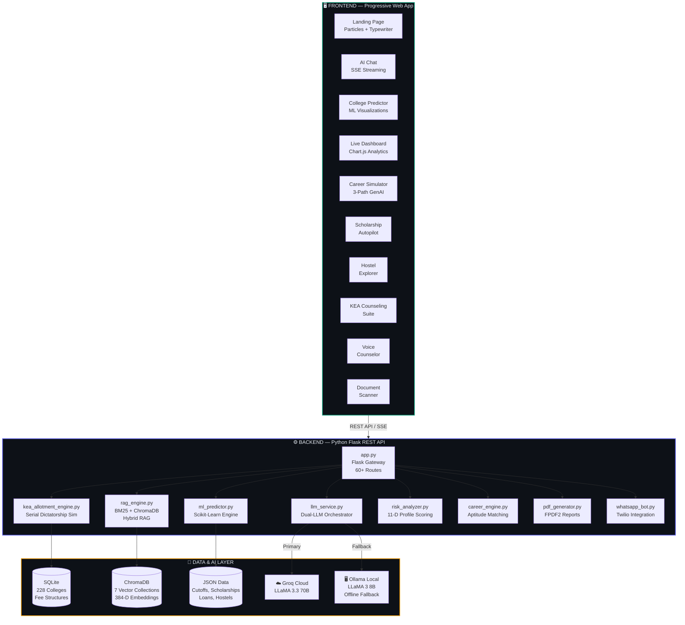
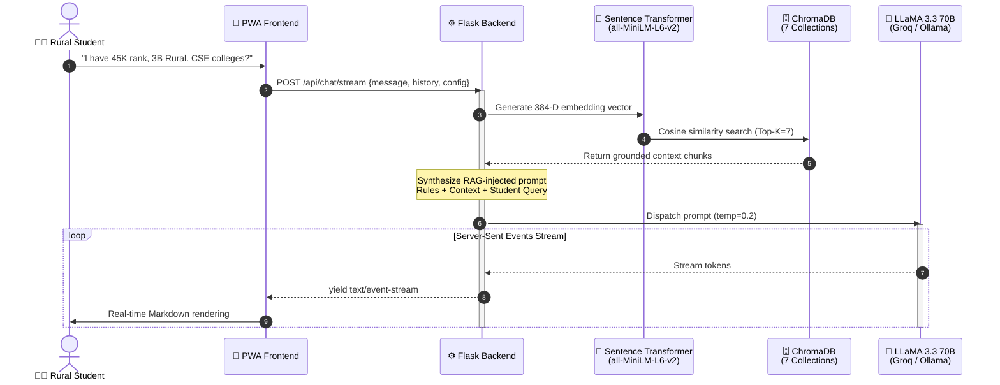
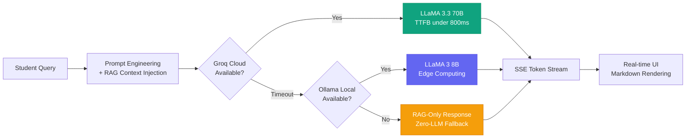

<div align="center">

<!-- Animated Header Banner -->
<picture>
  <source media="(prefers-color-scheme: dark)" srcset="https://capsule-render.vercel.app/api?type=waving&color=0:0d1117,50:10a37f,100:6366f1&height=300&section=header&text=InsightRural&fontSize=80&fontColor=ffffff&animation=fadeIn&fontAlignY=35&desc=AI-Powered%20Full-Stack%20Education%20Counsellor&descSize=22&descAlignY=55&descColor=94a3b8">
  <source media="(prefers-color-scheme: light)" srcset="https://capsule-render.vercel.app/api?type=waving&color=0:10a37f,50:6366f1,100:8b5cf6&height=300&section=header&text=InsightRural&fontSize=80&fontColor=ffffff&animation=fadeIn&fontAlignY=35&desc=AI-Powered%20Full-Stack%20Education%20Counsellor&descSize=22&descAlignY=55&descColor=e2e8f0">
  
</picture>

<br/>

<!-- Typing SVG -->
<a href="https://git.io/typing-svg"></a>

<br/>
<br/>

<!-- Premium Badges -->
<p>
  
  
  
  
  
  
</p>

<p>
  
  
  
  
  
  
  
</p>

<br/>

---

<h3>
  🎓 Bridging the Educational Guidance Gap for Rural India
</h3>

<p align="center" style="max-width: 750px; margin: 0 auto;">
  <strong>InsightRural</strong> is a Generative AI + Machine Learning full-stack platform that democratizes KCET/KEA college admission counseling for <b>230,000+</b> annual engineering aspirants in Karnataka — with a laser focus on <b>rural, first-generation learners</b> who lack access to expensive urban consulting agencies.
</p>

<br/>

[**🚀 Quick Start**](#-quick-start) •
[**✨ Features**](#-features-at-a-glance) •
[**🏗️ Architecture**](#️-system-architecture) •
[**🛠️ Tech Stack**](#️-technology-stack) •
[**📡 API Reference**](#-api-reference) •
[**🧪 Testing**](#-testing) •
[**🚢 Deployment**](#-deployment)

---

</div>

<br/>

## 🌟 Why InsightRural?

<table>
<tr>
<td width="50%">

### 🔴 The Problem

- **230,000+ students** compete for **~45,000** engineering seats via KCET annually
- Navigating **228+ institutions**, branch-specific cutoffs, multi-tiered fees, and complex reservation quotas (SC/ST/OBC 2A/2B/3A/3B/Rural/KM/HK 371J) is overwhelming
- **Rural students** lack professional counseling and advanced digital tools
- Results in **sub-optimal placements** and **forfeited scholarships**
- Existing tools require stable broadband — unavailable in rural Karnataka

</td>
<td width="50%">

### 🟢 Our Solution

- **AI Chat Counselor** powered by dual-LLM pipeline (Groq Cloud + Ollama offline fallback)
- **RAG-grounded responses** across 7 ChromaDB vector collections — zero hallucination tolerance
- **ML Prediction Engine** simulating KEA's Serial Dictatorship algorithm on 3 years of cutoff data
- **Offline-first PWA** optimized for low-bandwidth, legacy Android devices
- **100% privacy-preserving** — all student data stays in browser localStorage

</td>
</tr>
</table>

<br/>

## ✨ Features at a Glance

<div align="center">

```
╔══════════════════════════════════════════════════════════════════════════════╗
║                        INSIGHTRURAL FEATURE MATRIX                         ║
╠══════════════════════════════════════════════════════════════════════════════╣
║                                                                            ║
║  🎯 ML COLLEGE PREDICTOR        │  💬 GenAI RAG CHAT COUNSELOR             ║
║  RandomForest + GBR on 15K+     │  ChromaDB + BM25 hybrid retrieval        ║
║  cutoff records with Safe/      │  LLaMA 3.3 70B via Groq + local         ║
║  Moderate/Dream tiers           │  Ollama 8B fallback, SSE streaming       ║
║                                 │                                          ║
║  📋 KEA SEAT SIMULATOR          │  🧠 RISK & REGRET ANALYZER              ║
║  Full Karnataka reservation     │  11-dimensional profile analysis         ║
║  matrix: GM/SC/ST/2A/2B/3A/3B  │  with 5-year ROI projections and         ║
║  Rural 15% / KM 5% / HK 371J  │  regret-minimization scoring             ║
║                                 │                                          ║
║  📄 SCHOLARSHIP AUTOPILOT       │  🎭 GenAI CAREER SIMULATOR              ║
║  LLM-generated application     │  3-path career trajectories with         ║
║  essays + PDF export via FPDF2 │  aptitude-matched recommendations        ║
║                                 │                                          ║
║  🏛️ KEA COUNSELING SUITE        │  🗣️ VOICE COUNSELOR                     ║
║  Strategic option entry list    │  Speech-to-text AI guidance with         ║
║  generator + doc checklists    │  multilingual Kannada/Hindi/EN           ║
║                                 │                                          ║
║  🏠 HOSTEL EXPLORER             │  📱 WHATSAPP BOT                        ║
║  Hostel/PG discovery with      │  Twilio-integrated conversational        ║
║  proximity & budget filters    │  bot for non-smartphone users            ║
║                                 │                                          ║
║  📊 LIVE DASHBOARD              │  📷 DOCUMENT SCANNER                    ║
║  Real-time statistics and      │  OCR-powered marksheet & certificate     ║
║  counseling round analytics    │  scanning with auto-extraction           ║
║                                                                            ║
╚══════════════════════════════════════════════════════════════════════════════╝
```

</div>

<br/>

## 🏗️ System Architecture



### 🔄 RAG + LLM Pipeline — How a Query is Processed



<br/>

## 📂 Project Structure

```
InsightRural/
│
├── 📱 insightrural-frontend/          # Vanilla JS PWA (Port 8000)
│   ├── index.html                     # SPA entry point
│   ├── manifest.json                  # PWA manifest
│   ├── service-worker.js              # Offline caching & routing
│   ├── offline.html                   # Offline fallback page
│   ├── css/
│   │   ├── style.css                  # Global styles (13.5KB)
│   │   ├── components/                # Component-specific CSS
│   │   └── features/                  # Feature-specific CSS
│   ├── js/
│   │   ├── pwa.js                     # PWA registration & updates
│   │   ├── core/                      # State management & routing
│   │   ├── components/                # 23 modular UI components
│   │   │   ├── landing.js             # Animated landing (particles, typewriter)
│   │   │   ├── chat.js                # AI chat with SSE streaming
│   │   │   ├── predictor.js           # ML prediction UI (59KB)
│   │   │   ├── dashboard.js           # Live analytics dashboard
│   │   │   ├── career_simulator.js    # GenAI career paths
│   │   │   ├── scholarships.js        # Scholarship search & match
│   │   │   ├── scholarship_writer.js  # AI essay generation
│   │   │   ├── hostel_explorer.js     # Hostel/PG discovery
│   │   │   ├── voice_counselor.js     # Speech-to-text counselor
│   │   │   ├── risk_analyzer_component.js  # Risk & ROI analysis
│   │   │   ├── admissions.js          # Admissions workflow
│   │   │   ├── counseling_component.js # KEA counseling suite
│   │   │   ├── document_scanner.js    # OCR document scanner
│   │   │   └── ...                    # + 10 more components
│   │   └── features/                  # Feature modules
│   └── assets/                        # Icons, images, fonts
│
├── 🐍 college/backend/                # Python Flask API (Port 5000)
│   ├── app.py                         # Flask gateway (97KB, 60+ routes)
│   ├── llm_service.py                 # Dual-LLM orchestrator (Groq + Ollama)
│   ├── rag_engine.py                  # BM25 + ChromaDB hybrid RAG
│   ├── ml_predictor.py                # Scikit-Learn prediction engine (51KB)
│   ├── kea_allotment_engine.py        # KEA Serial Dictatorship simulator (57KB)
│   ├── risk_analyzer.py               # 11-dimensional risk scoring (39KB)
│   ├── career_engine.py               # AI career path simulator
│   ├── json_data_service.py           # JSON-first data layer (53KB)
│   ├── prompt_templates.py            # LLM prompt engineering (18KB)
│   ├── pdf_generator.py               # FPDF2 report generation
│   ├── whatsapp_bot.py                # Twilio WhatsApp integration
│   ├── scholarship_service.py         # Scholarship matching engine
│   ├── counseling_service.py          # KEA counseling logic
│   ├── document_scanner.py            # OCR document processing
│   ├── admissions_service.py          # Admissions workflow
│   ├── db_models.py                   # SQLAlchemy ORM models
│   ├── config.py                      # Environment configuration
│   ├── requirements.txt               # Python dependencies (54 packages)
│   ├── engines/                       # Ranking & constraint engines
│   ├── models/                        # Pydantic v2 schemas
│   ├── data/                          # JSON data (228 colleges, cutoffs)
│   ├── chroma_db/                     # Persistent vector DB
│   ├── vector_db/                     # Additional vector storage
│   └── tests/                         # 10+ test scripts, 30+ test cases
│
├── setup.py                           # Cross-platform setup & launcher
├── render.yaml                        # Render deployment config
└── README.md                          # You are here!
```

<br/>

## 🛠️ Technology Stack

<div align="center">

| Layer | Technologies | Purpose |
|:---:|:---|:---|
| **🖥️ Frontend** |     | Vanilla SPA with Service Worker, SSE streaming, Markdown parser, Chart.js |
| **⚙️ Backend** |     | REST API (60+ endpoints), SSE streaming, JWT auth, CORS |
| **🤖 AI / LLM** |    | Dual-LLM pipeline: Groq Cloud (70B) ↔ Ollama Local (8B) with auto-failover |
| **🔍 RAG** |   | 7 vector collections, `all-MiniLM-L6-v2` (384-D), BM25 hybrid search |
| **📊 ML** |    | RandomForest, GradientBoosting, Linear Regression on 15K+ records |
| **💾 Database** |   | Relational data (colleges, fees) + JSON file-based data service |
| **📄 Reports** |  | Scholarship essays, admission reports, analysis PDFs |
| **📱 Messaging** |   | WhatsApp bot for non-smartphone access |

</div>

<br/>

## 🚀 Quick Start

### Prerequisites

| Requirement | Version | Link |
|:---|:---|:---|
| Python | 3.10+ | [python.org/downloads](https://www.python.org/downloads/) |
| Git | Latest | [git-scm.com](https://git-scm.com/) |
| Groq API Key | Free tier | [console.groq.com](https://console.groq.com/) |

### ⚡ One-Command Setup

```bash
# 1️⃣ Clone the repository
git clone https://github.com/Basava999/InsightRural--an-ai-powered-full-stack-education-counsellor.git
cd InsightRural--an-ai-powered-full-stack-education-counsellor

# 2️⃣ Run the automated setup (creates venv, installs all 54 dependencies, copies .env)
python setup.py

# 3️⃣ Add your free Groq API key
#    → Get key at: https://console.groq.com (free tier available)
#    → Edit: college/backend/.env → set GROQ_API_KEY=your_key_here

# 4️⃣ Launch both servers
python setup.py --start
```

<div align="center">

| Service | URL | Description |
|:---:|:---:|:---|
| 🖥️ **Frontend** | [`http://localhost:8000`](http://localhost:8000) | PWA Interface |
| ⚙️ **Backend API** | [`http://127.0.0.1:5000`](http://127.0.0.1:5000) | Flask REST API |

</div>

### 🔧 Manual Setup (Alternative)

<details>
<summary><b>Click to expand manual setup instructions</b></summary>

```bash
# ── Backend ──────────────────────────────────────────────
cd college/backend
python -m venv .venv

# Windows:
.venv\Scripts\activate
# macOS/Linux:
source .venv/bin/activate

pip install -r requirements.txt
cp .env.example .env              # Edit with your API keys
python app.py                     # Starts on http://127.0.0.1:5000

# ── Frontend (new terminal) ─────────────────────────────
cd insightrural-frontend
python -m http.server 8000        # Opens http://localhost:8000
```

</details>

### 🔑 Optional: Offline AI with Ollama

<details>
<summary><b>Enable fully offline LLM inference</b></summary>

```bash
# Install Ollama (one-time)
# → https://ollama.com/download

# Pull the LLaMA 3 model
ollama pull llama3

# The system auto-detects Ollama at localhost:11434
# No .env changes needed — it's the automatic fallback
```

> **Without Ollama or Groq**: College recommendations, ML predictions, risk analysis, KEA simulator, and dashboard all work completely offline. Only the AI Chat feature requires an LLM backend.

</details>

<br/>

## ⚙️ Configuration

Create `college/backend/.env` from the example:

```env
# ═══════════════════════════════════════════════════════════
# 🔑 REQUIRED — for AI chat features
# ═══════════════════════════════════════════════════════════
GROQ_API_KEY=your_groq_api_key_here          # Free at console.groq.com

# ═══════════════════════════════════════════════════════════
# 🔌 OPTIONAL — for offline AI fallback
# ═══════════════════════════════════════════════════════════
OLLAMA_HOST=http://localhost:11434
OLLAMA_MODEL=llama3

# ═══════════════════════════════════════════════════════════
# 🔒 SECURITY — change in production!
# ═══════════════════════════════════════════════════════════
JWT_SECRET_KEY=change_this_to_a_secure_random_secret
```

<br/>

## 📡 API Reference

<div align="center">

### Core Endpoints (60+ total)

</div>

<details>
<summary><b>🏫 College Data APIs</b></summary>

| Method | Endpoint | Description |
|:---:|:---|:---|
| `GET` | `/api/health` | System health check |
| `GET` | `/api/colleges` | Searchable college directory (228 institutions) |
| `GET` | `/api/branches` | Engineering branch listing |
| `GET` | `/api/locations` | Geographic zone data |
| `GET` | `/api/statistics` | Live platform statistics |

</details>

<details>
<summary><b>🤖 AI Chat APIs</b></summary>

| Method | Endpoint | Description |
|:---:|:---|:---|
| `POST` | `/api/chat` | RAG AI counselor chat (synchronous) |
| `POST` | `/api/chat/stream` | Real-time SSE streaming chat |

</details>

<details>
<summary><b>📊 ML Prediction APIs</b></summary>

| Method | Endpoint | Description |
|:---:|:---|:---|
| `POST` | `/api/predict/college` | ML-driven KCET predictions (Safe/Moderate/Dream) |
| `POST` | `/api/recommend/colleges` | Personalized college recommendations |
| `GET` | `/api/predict/status` | Prediction engine status |

</details>

<details>
<summary><b>🎓 Counseling & Scholarship APIs</b></summary>

| Method | Endpoint | Description |
|:---:|:---|:---|
| `POST` | `/api/recommend/scholarships` | Scholarship matching engine |
| `POST` | `/api/scholarships/generate-essay` | AI scholarship essay generator |
| `POST` | `/api/counseling/generate-options` | KEA option entry list generator |
| `POST` | `/api/simulate-career` | GenAI career simulator (3 paths) |
| `POST` | `/api/report/generate` | PDF report generation |

</details>

<details>
<summary><b>👤 Auth & Utility APIs</b></summary>

| Method | Endpoint | Description |
|:---:|:---|:---|
| `POST` | `/api/auth/signup` | User registration |
| `POST` | `/api/auth/login` | JWT authentication |
| `POST` | `/api/documents/scan` | OCR document scanner |

</details>

<br/>

## 🧠 AI & ML Deep Dive

### Dual-LLM Orchestration Pipeline



### RAG Knowledge Base — 7 Vector Collections

| Collection | Documents | Use Case |
|:---|:---:|:---|
| 🏫 **Colleges** | 228 | Institution details, branches, infrastructure, placements |
| 📈 **Cutoff Trends** | 3 years | Historical KCET cutoffs (2022-2024) across all categories |
| 💰 **Fee Structures** | 6 tiers | GM/SC-ST/OBC/SNQ/Management fee matrices |
| 🎓 **Scholarships** | 50+ | State/national scholarships with eligibility criteria |
| 🏦 **Education Loans** | 20+ | Bank-wise loan schemes, interest rates, collateral rules |
| 🏠 **Hostels** | 100+ | Hostel/PG options with proximity and budget data |
| 📋 **Counseling Guides** | 10+ | KEA process guides, document checklists, round strategies |

### ML Prediction Engine

| Component | Algorithm | Training Data |
|:---|:---|:---|
| **College Predictor** | RandomForest + GradientBoosting Regressor | 15,000+ KEA cutoff records (2022-2024) |
| **KEA Simulator** | Serial Dictatorship Algorithm | Full reservation matrix simulation |
| **Risk Analyzer** | 11-dimensional weighted scoring | Historical placement + ROI data |
| **Reservation Logic** | Category-specific relaxation factors | GM, SC, ST, OBC (2A/2B/3A/3B), Rural 15%, KM 5%, HK 371J 8%/70% |

<br/>

## 🧪 Testing

The testing infrastructure validates both **deterministic software behavior** and **non-deterministic AI output quality** across a triple-fallback architecture.

```
Test Infrastructure
├── test_all_endpoints.py          # Full API endpoint validation
├── verify_full_system.py          # End-to-end system verification
├── verify_genai.py                # LLM pipeline integrity testing
├── verify_scholarship_feature.py  # Scholarship service validation
├── verify_counseling.py           # Counseling workflow testing
├── test_smart_search.py           # RAG search accuracy testing
├── test_sarvam_rag.py             # Multilingual RAG testing
├── test_kea_engine.py             # KEA allotment engine testing
├── test_risk_full.py              # Risk analyzer validation
└── test_json_service.py           # Data layer testing
```

### Run Tests

```bash
cd college/backend

# Run all tests
python -m pytest tests/ -v

# Individual test suites
python verify_full_system.py       # Full system check (30+ test cases)
python verify_genai.py             # AI pipeline verification
python test_kea_engine.py          # KEA simulator validation
```

### Performance SLAs

| Metric | Target | Measured |
|:---|:---:|:---:|
| Groq TTFB (Time to First Byte) | < 800ms | ✅ ~500ms |
| ML Prediction (228 colleges x 3 years) | < 1.5s | ✅ ~1.1s |
| RAG Retrieval (Cosine similarity search) | < 200ms | ✅ ~120ms |
| Frontend TTI (Time to Interactive) | < 2s | ✅ ~1.4s |
| Total UI Payload (CSS + JS + HTML) | < 3 MB | ✅ ~2.1 MB |

<br/>

## 🚢 Deployment

<div align="center">

| Platform | Layer | Guide |
|:---:|:---:|:---:|
|  | Backend API | [Deploy to Render](#deploy-backend-to-render) |
|  | Frontend PWA | [Deploy to Vercel](#deploy-frontend-to-vercel) |

</div>

<details>
<summary id="deploy-backend-to-render"><b>🔧 Deploy Backend to Render</b></summary>

1. Push code to GitHub
2. Create a new **Web Service** on [Render](https://render.com)
3. Connect your GitHub repo — Render auto-detects `render.yaml`
4. Set environment variables:
   - `GROQ_API_KEY` → your Groq key
   - `PYTHON_VERSION` → `3.10.0`
5. Deploy and copy your backend URL

</details>

<details>
<summary id="deploy-frontend-to-vercel"><b>🌐 Deploy Frontend to Vercel</b></summary>

1. Import your GitHub repo on [Vercel](https://vercel.com)
2. Set **Root Directory** to `insightrural-frontend`
3. Set **Framework Preset** to `Other`
4. Deploy — Vercel provides a production URL
5. Update the API base URL in `js/core/state.js` with your Render backend URL

</details>

> **⚠️ Notes:**
> - SQLite on Render is ephemeral (data resets on restart). For production, use PostgreSQL.
> - Render free tier has cold starts (~50s for first request after inactivity).

<br/>

## 🔒 Security Architecture

<div align="center">

| Layer | Implementation |
|:---:|:---|
| 🔐 **Authentication** | JWT-based auth with bcrypt password hashing |
| 🛡️ **Input Validation** | Pydantic v2 schemas validate all API inputs |
| 🔑 **Secret Management** | `.env` files gitignored — zero secrets in repo |
| 🏠 **Data Privacy** | All student PII stays in browser `localStorage` — never sent to cloud |
| 🔄 **Failover Security** | Triple fallback: Groq → Ollama → RAG-only (never returns blank) |
| 🚦 **Rate Limiting** | Flask-Limiter on all public endpoints |
| 🌐 **CORS** | Flask-CORS with configurable origin whitelist |

</div>

<br/>

## 🗺️ Roadmap

- [ ] 🏥 **NEET Medical Admissions** — Expand to Karnataka medical college predictions
- [ ] 🌾 **Agricultural Sciences** — Add agriculture university support
- [ ] 💊 **Pharmacy Matrix** — Pharmacy admission counseling
- [ ] 🗣️ **Kannada Voice AI** — Full-duplex voice-to-voice in native Kannada using KASR
- [ ] 🗣️ **Hindi Support** — Expand multilingual voice to Hindi and regional dialects
- [ ] 🐘 **PostgreSQL Migration** — Persistent database for production deployments
- [ ] 📊 **Real-time Cutoff Updates** — Live KEA round-by-round cutoff tracking
- [ ] 🤝 **Peer Mentorship Network** — Connect rural students with college seniors

<br/>

## 🤝 Contributing

Contributions are welcome! Here's how you can help:

1. 🍴 **Fork** the repository
2. 🌿 **Create** a feature branch (`git checkout -b feature/amazing-feature`)
3. 💾 **Commit** your changes (`git commit -m 'Add amazing feature'`)
4. 📤 **Push** to the branch (`git push origin feature/amazing-feature`)
5. 🔃 **Open** a Pull Request

<br/>

## 📜 License

Developed for **final-year academic research** and **production demonstration** at **M.S. Ramaiah Institute of Technology (MSRIT) — Pradarshana 2026**.

<br/>

## 🙏 Acknowledgments

- **M.S. Ramaiah Institute of Technology** — Academic supervision and infrastructure
- **Karnataka Examinations Authority (KEA)** — Public cutoff data
- **Groq** — Free-tier LLM inference API
- **Meta AI** — LLaMA 3 open-source language model
- **ChromaDB** — Open-source vector database
- **Ollama** — Local LLM runtime for offline inference

<br/>

---

<div align="center">

<br/>


<br/>

**Built with ❤️ for Rural Karnataka Students**

<br/>

<p>
  <a href="https://github.com/Basava999/InsightRural--an-ai-powered-full-stack-education-counsellor/stargazers">
    
  </a>
  &nbsp;&nbsp;
  <a href="https://github.com/Basava999/InsightRural--an-ai-powered-full-stack-education-counsellor/network/members">
    
  </a>
  &nbsp;&nbsp;
  <a href="https://github.com/Basava999/InsightRural--an-ai-powered-full-stack-education-counsellor/watchers">
    
  </a>
</p>

<p>
  <sub>If InsightRural helped you, consider giving it a ⭐</sub>
</p>

</div>
